# Rock 'n' Roller II: Hollywood Nights

Rock, the boulder, has been cast in a picture. It is called *Like a Rock*, it
is shooting nights, and nobody asked whether he could act. Roll through ten
night shoots on a Hollywood studio lot, from the casting office to the
premiere, and run into the annoying people you find on a film set, and in the
pictures being made on it, fast enough to smash them. Every set is shot on its
own film stock, lit by its own rig, and scored by its own band, and all of it
keeps the beat.

The sequel to [Rock 'n' Roller](https://github.com/h1ddenpr0cess20/rocknroller),
on the same engine, now the
[Madness Engine](https://github.com/h1ddenpr0cess20/madness-engine) (the
renderer, physics, camera, stage and sound), with the sets, cast, props,
light rig, score and rules all redone for the pictures. The title and the
picture inside it are nods to two Bob Seger songs, "Hollywood Nights" and
"Like a Rock". Only their names are used.

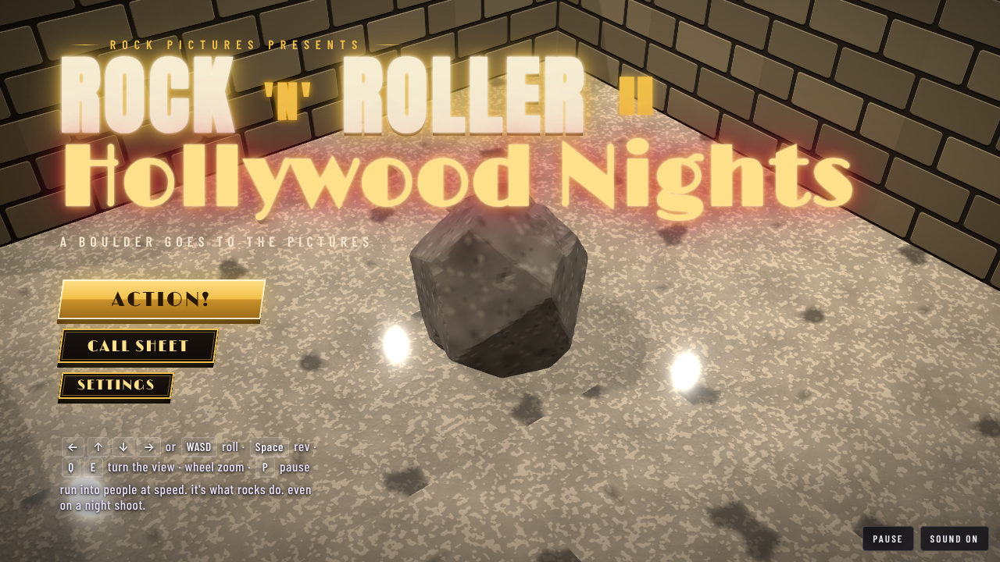

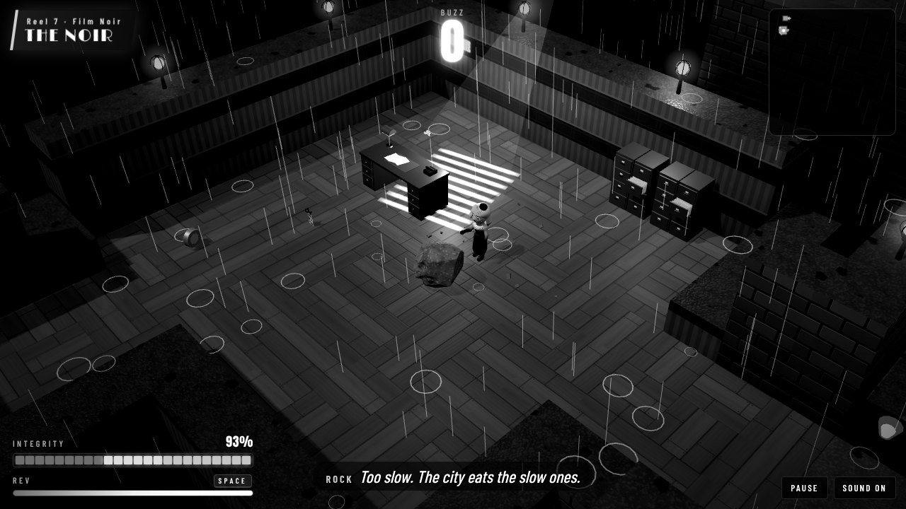

## Run

```sh
git clone https://github.com/h1ddenpr0cess20/rocknroller-ii
cd rocknroller-ii
npm install
npm run dev               # → http://localhost:5173
```

It is a static page: no server, no keys. `npm run build` puts it in `dist/`,
which runs from any folder or path. It uses WebGPU where the browser has it and
WebGL2 otherwise. Node 22.12 or later.

## Play

| | |
|---|---|
| <kbd>←</kbd><kbd>↑</kbd><kbd>↓</kbd><kbd>→</kbd> or <kbd>WASD</kbd> | Roll. The sets run diagonally across the screen, so hold two at once. |
| <kbd>Space</kbd> or <kbd>Shift</kbd> | **Rev**: hold to charge. Harder push and a higher top speed, until it runs dry. |
| Hold the mouse or a finger | Roll toward the pointer. The further it is from Rock, the harder the push. On a touch screen there is a REV button. |
| <kbd>Q</kbd> <kbd>E</kbd>, or drag with the right mouse button | Turn the view. Dragging up and down tilts it. |
| Mouse wheel, or <kbd>+</kbd> <kbd>−</kbd> | Zoom. |
| Two fingers | Pinch to zoom, twist to turn, drag up or down to tilt. |
| <kbd>C</kbd> | Put the view back. |
| <kbd>Enter</kbd> / <kbd>Space</kbd> | Action, and carry on after a scene. |
| Gamepad | Left stick or d-pad rolls; right stick turns and tilts; shoulder buttons zoom; <kbd>A</kbd>, <kbd>X</kbd> or the right trigger revs; <kbd>Start</kbd> pauses. |
| <kbd>P</kbd> / <kbd>Esc</kbd> | Hold the roll (pause). |
| <kbd>M</kbd> | Sound on or off. |

### Speed is everything

How hard Rock hits someone depends on how fast he was going, in tiles a
second. Everybody has a **toughness**, the speed it takes to smash them in one
go, and a **power**, how much it hurts to bounce off them.

| Speed | | What happens |
|---|---|---|
| 1.7 times what it takes (13 at the least) | **Flattened** | Gone, with double the buzz. |
| At least their toughness | **Smash** | Gone, and it costs Rock nothing. |
| Over half their toughness | **Bonk** | You both bounce. It costs Rock some of their power, less the closer you were to a smash. |
| Under that | **Tap** | It hurts, all of their power, and they don't move. |

The set dressing is fair game too: cameras, lamps, chairs, desks, cars, coffins
and cannons all go over if Rock comes at them fast enough (the bigger, the
faster), for a little buzz. Someone who isn't smashed is still worn down, and a
doorman you can't hit hard enough can be hit twice. The three bosses take a
good deal more than that.

### Staying in one piece

- **Integrity** starts at 100. Knocks, zaps, falling sandbags, pyro, steam and falls take it away; **gaffer tape** puts 25 back.
- At nothing, Rock shatters, unless he picked up a **clapperboard**: take two, and Rock gets back up on half.
- **Buzz** is the score. Popcorn and buckets of it are worth a little; smashing people is worth more, and smashing them one after another builds a combo (up to ×5) that multiplies each one.

### Stars

Each scene gives up to three:

1. **Hit your mark**: get to the end of the scene.
2. **Scene-stealer**: smash three in four of the people in the way.
3. **In the can**: find all three golden reels.

Your stars, best buzz and best time for each scene are kept in the browser's
local storage (`rocknroller2.v1`), and each scene opens when you wrap the one
before. The game plays the same with storage blocked.

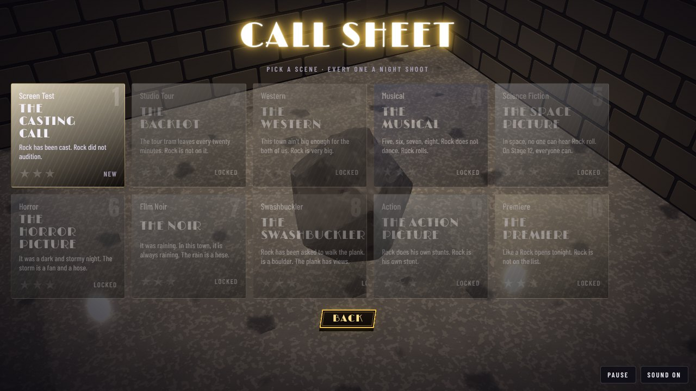

### What is in the way

- **Closed sets**: a gate across the way on. Find the **studio pass** on the same set to open it.
- **Breakaways**: scenery flats, curtains, sugar glass, painted brick and balsa walls. Run at one fast enough and it gives way. Behind them are usually golden reels.
- **Drops**: sandbags, lighting rigs, crates off a hoist, chandeliers and a papier-mâché boulder, coming down on the beat. Wait for the moment they go up.
- **Pyro** goes up out of the floor on the beat; in the noir, the manholes steam.
- **Live cable** zaps whatever rolls onto it.
- **Rides**: camera dollies, the studio tram, rafts, a mine cart, a flying saucer, forklifts, the stage elevator, and in the Premiere's orchestra pit, the fans' hands. Get on while they wait.
- **Sticky floors** (mud, fake blood) slow Rock; **belts** carry him; **bumpers** (velvet ropes, barrels, cacti, hydrants) throw him back.

## The shoot

Every set is laid out its own way, shot on its own stock and scored in its own
genre.

| | Set | The way through |
|---|---|---|
| 1 | **The Casting Call** | The casting office after hours: a queue of hopefuls with their headshots, a waiting room of plastic chairs, sandbags behind Stage 7, the screen-test stage, wardrobe and a closed set. Teaches the lot. Bossa nova on hold. |
| 2 | **The Backlot** | The lot after dark under the searchlights: New York Street's façades, the studio tram over the flash-flood channel, a raft out on the water tank, the stunt show's pyro, soundstage alley, the props warehouse. The main title, a night drive with a pumping bass. |
| 3 | **The Western** | In sepia. Down off Boot Hill, along a Main Street churned to mud, a saloon with a sugar-glass mirror, the sheriff's office, the livery and its pantomime horse, and the mine, where the dynamite goes up on the beat and a mine cart crosses the chasm. A whistle over a train beat. |
| 4 | **The Musical** | In Technicolor. The dressing rooms, a grand staircase lined with bulbs, the ballroom under the lot's one mirror ball, a line of hoofers, the stage elevator down to the understage, and **the Director**, who lunges for the close-up. A big band, swinging. |
| 5 | **The Space Picture** | A plywood starship on Stage 12: the airlock, live plasma conduits, the bridge on red alert, walkways along the hull, the engine room's presses, and a flying saucer across to the alien planet. Synths, four on the floor. |
| 6 | **The Horror Picture** | The haunted house on Stage 13: a graveyard of zombie extras under machine lightning, the great hall, a library with a bookcase that turns, a corridor slick with fake blood, the Mummy in the crypt. An organ, a theremin, a heartbeat. |
| 7 | **The Noir** | In black and white, in the rain, with Rock narrating in a voice like a wet cigarette: wet streets and steaming manholes, the detective's office with the light through the blinds, the Rock Bottom Club, the docks, and **Mr. Big**, who moves only on the beat. Brushes, a walking bass, a sax. |
| 8 | **The Swashbuckler** | A galleon in the studio tank: down the rigging from the crow's nest, the quarterdeck's wheel and powder kegs, the cannons along the main deck, a reel at the end of the plank, the hold, the captain's cabin, and Treasure Island. A fiddle and a snare marching. |
| 9 | **The Action Picture** | Off the helipad, down the fire stairs, across a tower going up on forklifts, a reel through sugar glass, the parking garage, the freeway set running on belts, and the stunt hangar's airbags. Guitars through the distortion, double kick. |
| 10 | **The Premiere** | *Like a Rock* opens tonight, and Rock is not on the list. The boulevard under the searchlights, the red carpet under the marquee with his name on it, the lobby, the raked stalls, across the orchestra pit on the fans' hands, and onto the stage under the giant gold statue, where **the Mogul** stamps. The main title, with the brass out. |

| | |
|---|---|
| 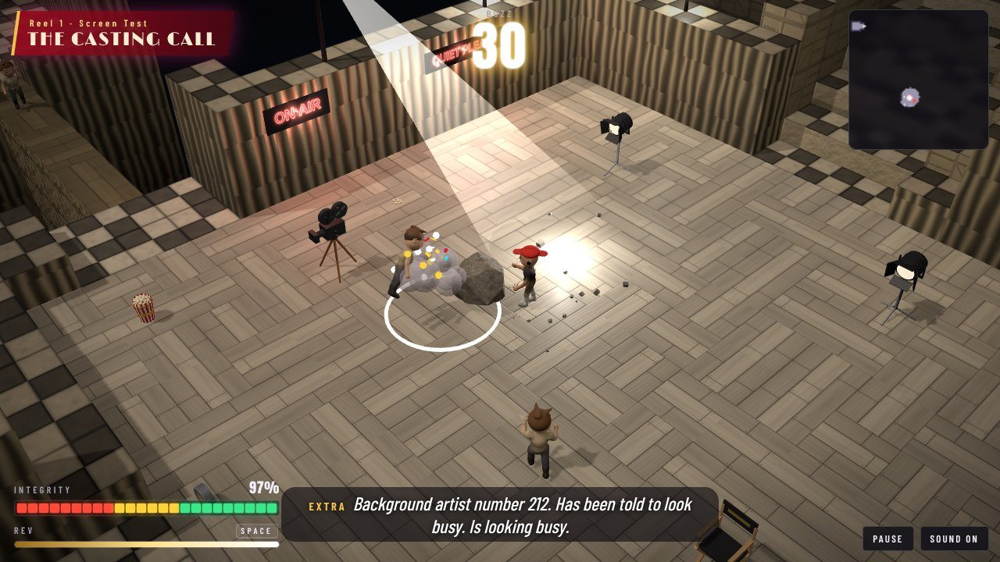 | 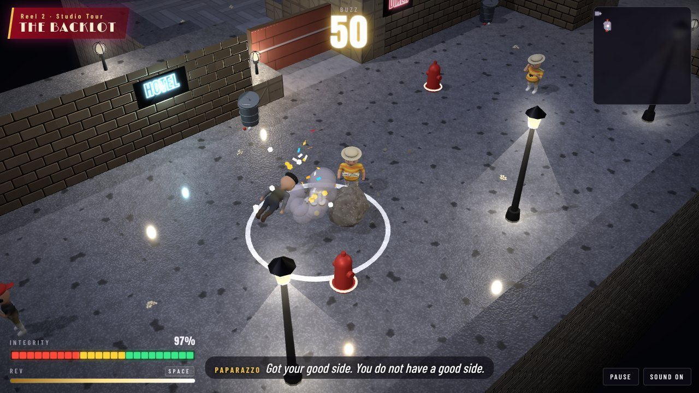 |
| 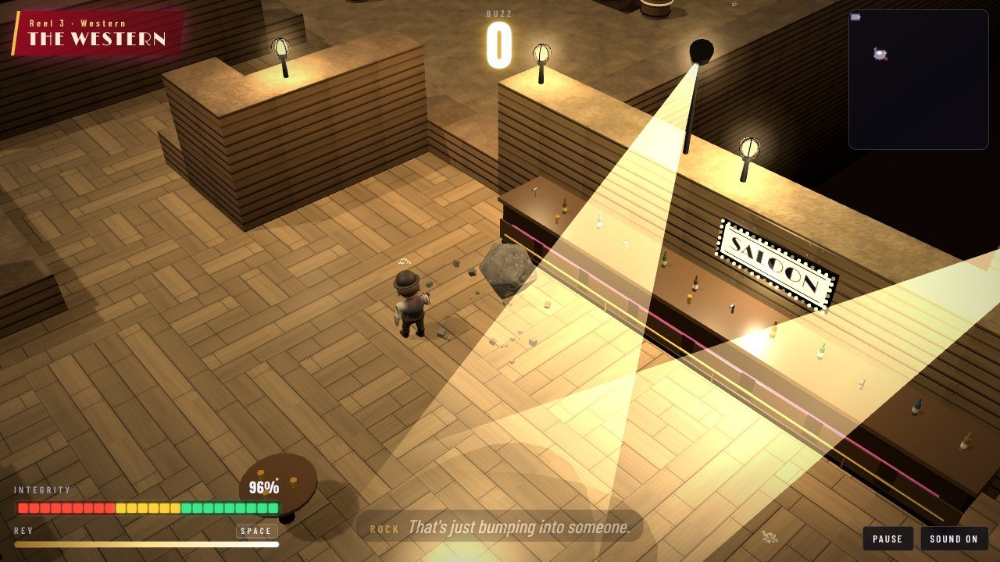 | 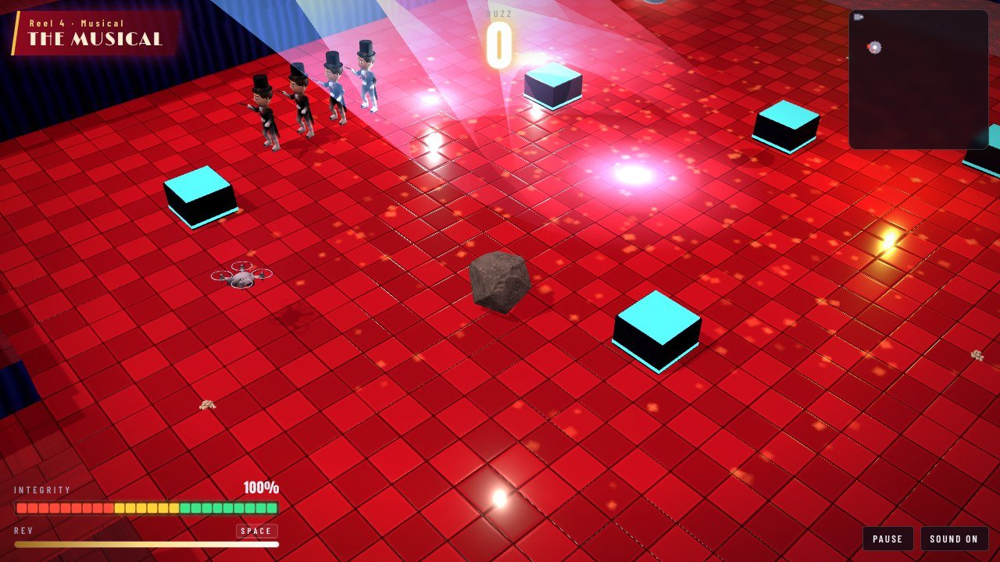 |
| 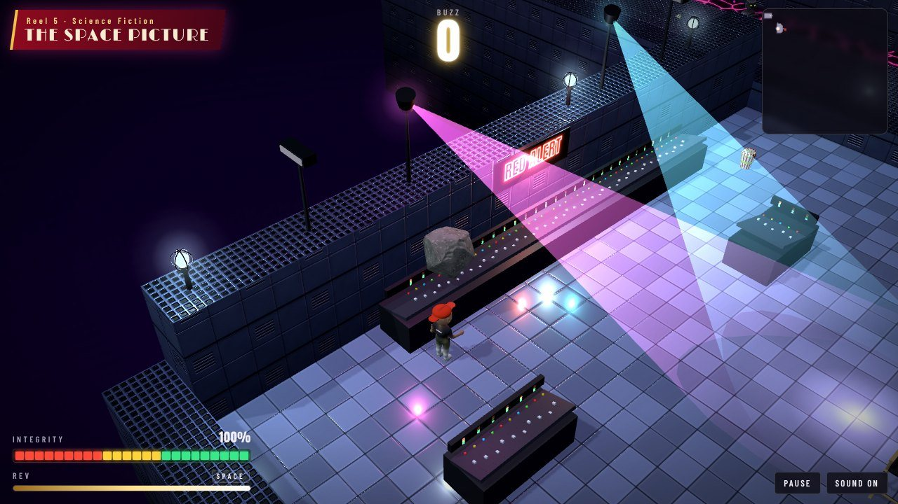 | 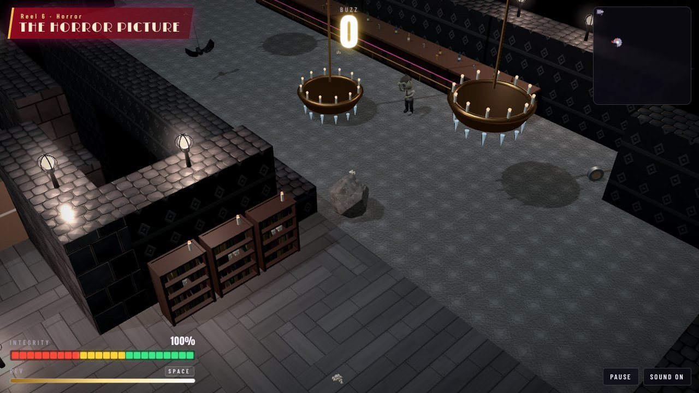 |
|  | 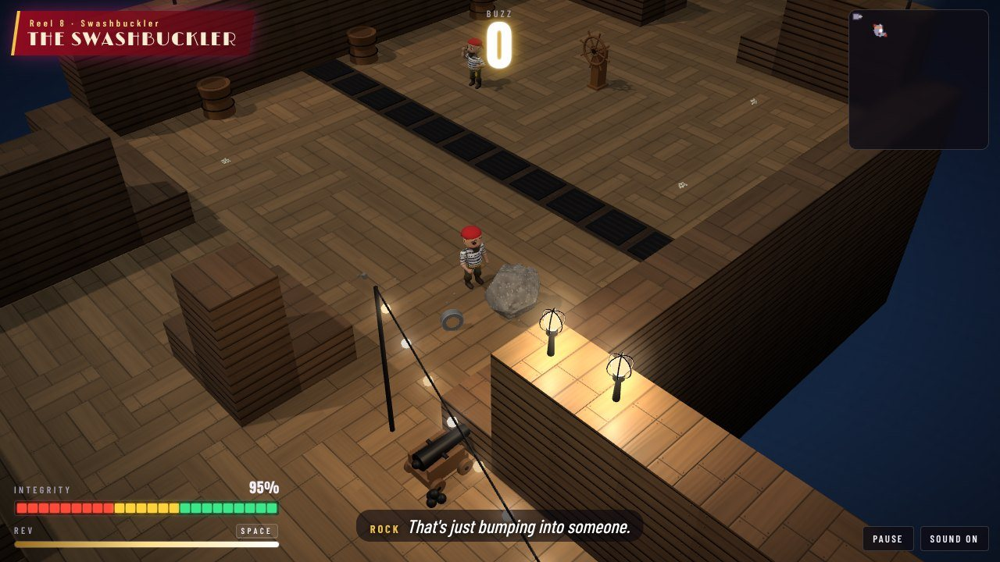 |
| 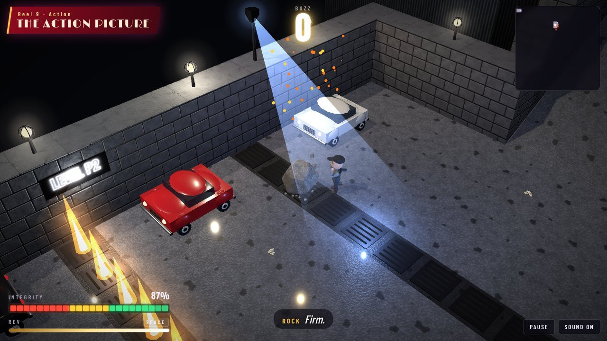 | 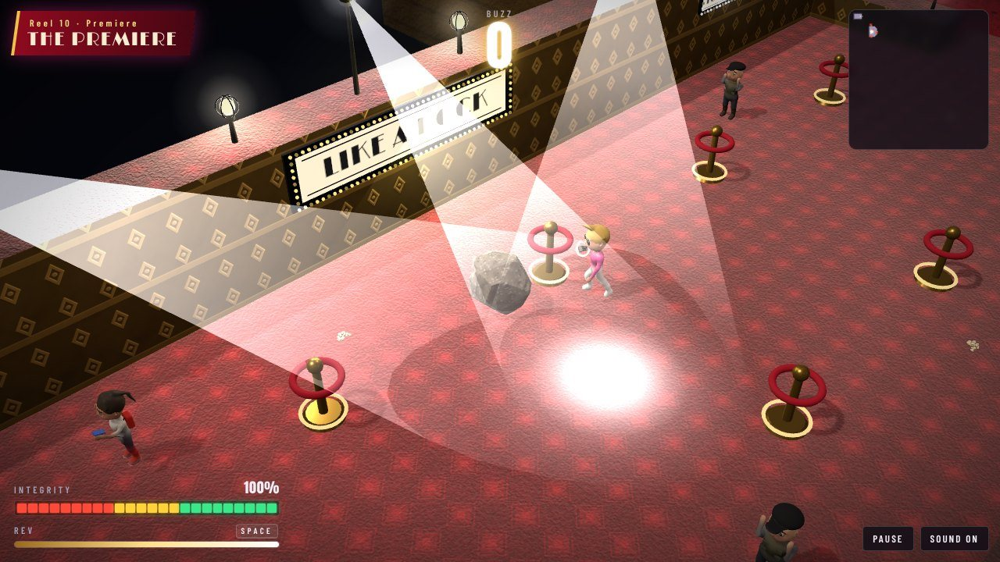 |

## The film stock and the light rig

Each set is graded on its own stock (`look.grade`): sepia for the Western,
Technicolor for the Musical, a washed-out, bloodless stock for the horror, a
cooler, brighter one for space, and for the noir, hard black and white with heavy grain, the interface
included. A fine grain and a vignette sit over every set, as on a print. The
noir also has rain, falling in lines and splashing on the floor.

The rig (the engine's `scenery/lightshow.rocknroller-ii`) keeps the beat of
the score:

| Fixture | What it does |
|---|---|
| **bulb**, **par**, **spot**, **strobe**, **ball**, **laser**, **neon**, **chandelier**, **festoon** | The first game's rig. There is one mirror ball, in the Musical. |
| **klieg** | A searchlight: a long beam sweeping the sky over the lot. |
| **marquee** | A sign of bulbs round lettering in the marquee face: LIKE A ROCK over the red carpet, SALOON, SHERIFF, BROADWAY MELODY. |
| **blinds** | Light through a venetian blind, laying bars across the floor. The detective's office. |
| **streetlamp** | A lamp post and its cone of light on the wet street. |

Strobes and the horror picture's lightning never flash more than three times
in any second, and **Settings → Flashing lights** turns them, and the
paparazzi's flashbulbs, down to a glow.

## The score

Played live in Web Audio (the engine's `music/band.rocknroller-ii`), with no
audio files: a theme per genre, each with its own drums, bass line, comping
and lead. The main title (the Backlot, the title screen, and the Premiere with
the brass out) is a night drive at 146 bpm over a driving, pumping eighth-note
bass that steps up into each change. Bossa nova and vibes in the casting
office; a train beat and a whistle for the Western; a swinging big band and a
trumpet for the Musical; four on the floor and a square lead in space; an
organ and a theremin for the horror; brushes, a walking bass and a sax for the
noir; a march and a fiddle for the pirates; chugging guitars for the action
picture. The beat clock drives the hazards and the lights.

## The cast

Sculpted in code (the engine's `characters/`, listed in `src/models/cast/`)
and baked in background workers while the page loads. The crew and the
hopefuls: extras, production assistants, paparazzi, studio tourists, autograph
hunters, agents, make-up artists, film critics, influencers, ushers, studio
security, doormen, a costume character and stunt doubles. And the people in
the pictures: a cowboy, a saloon extra, a pantomime horse, hoofers in top
hats, a tin robot, a rubber alien, camera drones, zombie extras, the Mummy, a
rubber bat on its wire, hoods, muscle, a flatfoot, the dame, a newsie, pirates
and an animatronic parrot. They share a costume department (`wardrobe.js`):
fedoras, stetsons, top hats, berets, peaked caps, tricorns, bowlers, glasses,
suit fronts, moustaches, beards, eye patches and bandanas.

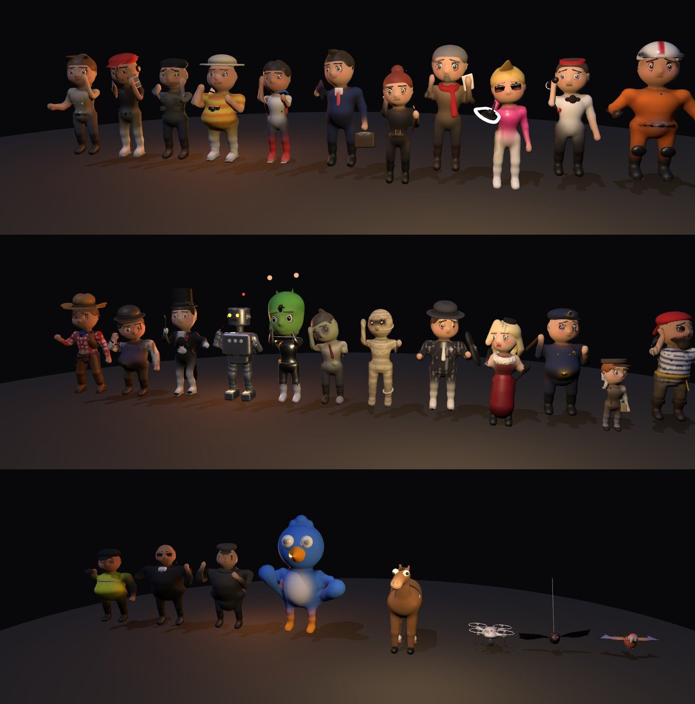

And three bosses, each fought differently: **the Director** in his beret and
jodhpurs, megaphone up, who lunges for the close-up and then has to get his
breath back; **Mr. Big** in his white dinner jacket, who moves only on the
beat; and **the Mogul**, who owns the studio, holds the gold statuette like a
club, and stamps so the floor throws Rock back.

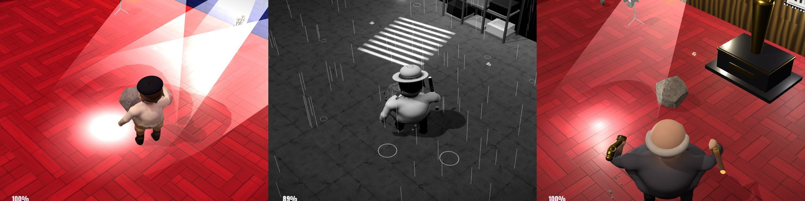

The props are built from plain shapes in `src/dressing.js`: cameras with
their reels turning, lamps on stands, director's chairs, craft services,
forties sedans, golf carts, tombstones, coffins, sleep pods, cannons, a ship's
wheel, treasure chests, stunt airbags and the giant gold statue.

## On the engine

The game runs on the
[Madness Engine](https://github.com/h1ddenpr0cess20/madness-engine), which
`npm install` fetches from GitHub. The renderer (WebGPU, or WebGL 2), the
physics, the controls, the arcade camera, the stage, the film, the sound, the
flying bits and the weather, the save slot and the sculpting kit are the
engine's, and so are Rock (`heroes/rock`), the rig
(`scenery/lightshow.rocknroller-ii`), the score (`music/band.rocknroller-ii`),
the sets' textures (`textures/venue.rocknroller-ii`), the cast and props
(`characters/…`, `props/…`) and each set's mood (`moods/casting` and the rest:
its light, sky, reflections and film stock), all from the engine's library.
What is left here is the game: the sets, the rules, the machinery, the props
and the HUD, and the game's own sounds and bits on the engine's (`audio.js`,
`effects.js`). The rosters (`src/models/cast/index.js`,
`src/models/props/index.js`) say who is in the game and take each one from the
library.

## Develop

```sh
npm run dev       # the game, with hot reload
npm run build     # a static build in dist/
npm test          # node's test runner
npm run lint
```

The tests cover the rules (smashing, buzz, integrity, take two, stars,
storage), the light rig and the strobe limit, the score, the physics and
camera, and every set: each one has to be wrapped start to finish, with all
three golden reels, by an autopilot (`test/helpers/autopilot.js`) that plans a
route, waits out the drops and the pyro, takes a run-up at the breakaways,
fetches the passes and duels the bosses. Every pickup has to be somewhere Rock
can reach and out of the hazards; every sign has to hang on a wall the width
of it; every prop has to be built, fit its footprint and face open floor;
everyone in the way has to be sculpted.

Other things in the box:

```sh
node scripts/map.js 7            # a set as text (they count from 1); --overlaps shows two pieces dug over each other
node scripts/drive.js 7          # put the autopilot through a set and say how it went
node scripts/bake.js             # bake every model and say what came out
```

`models.html` is a turntable for the cast (`?m=director,mrbig,mogul`), and in
the browser console `rocknroller.debug.venue(i)` jumps to a set and
`teleport(x, z)` puts Rock somewhere on it.

## Credits

Rock is [Rock](https://github.com/h1ddenpr0cess20/rock)'s boulder. The engine
is the [Madness Engine](https://github.com/h1ddenpr0cess20/madness-engine),
which grew out of [Rock 'n' Roller](https://github.com/h1ddenpr0cess20/rocknroller)'s
and [dungeon-roller](https://github.com/h1ddenpr0cess20/dungeon-roller). Type is
Anton, Barlow Condensed and Limelight, from [Fontsource](https://fontsource.org).
See also [other games](docs/other-games.md).
